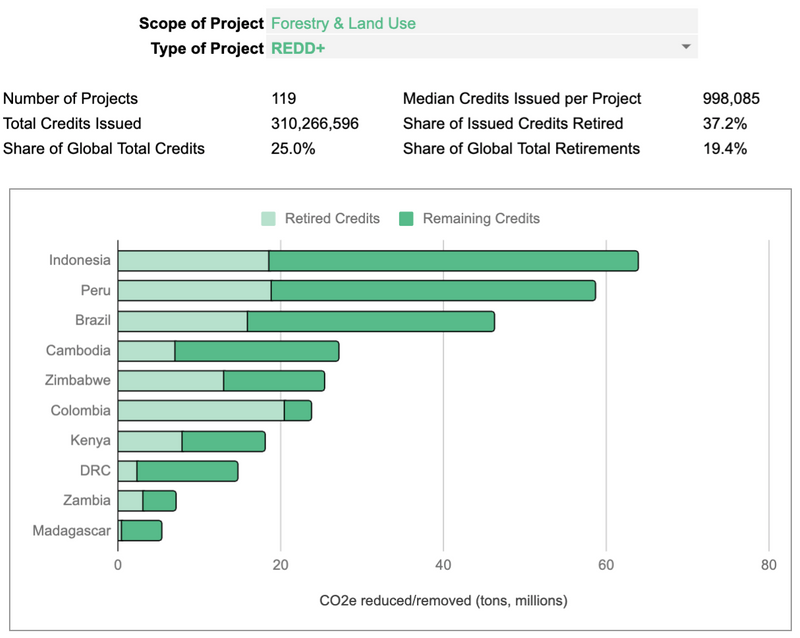
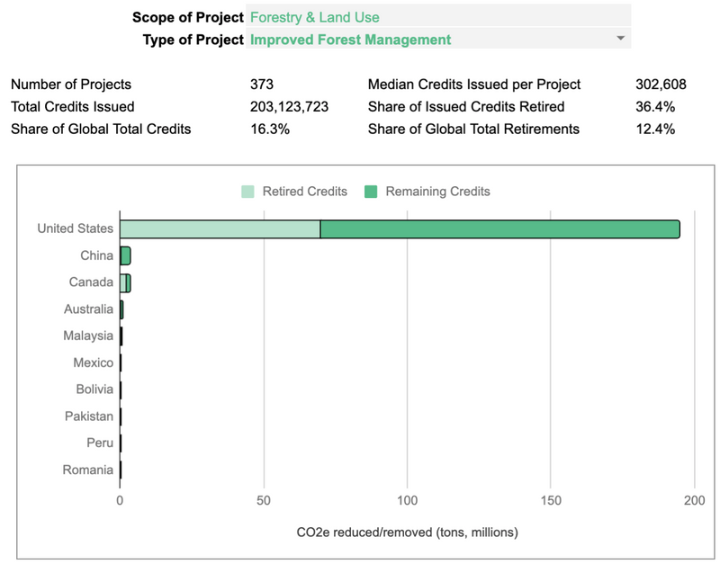
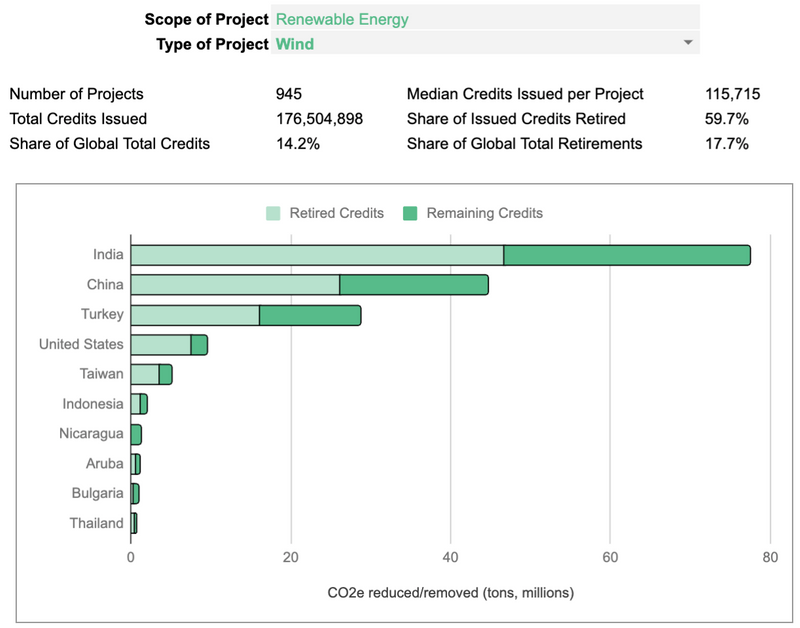
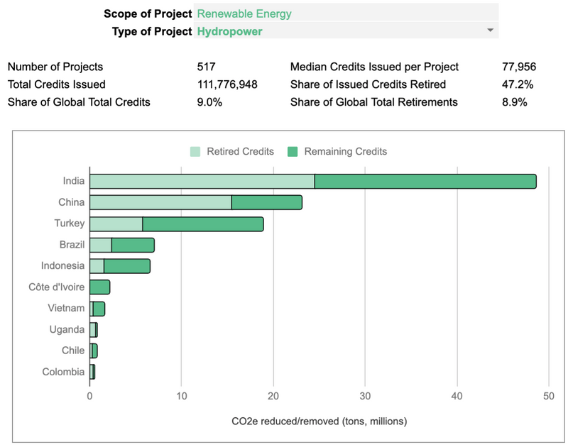
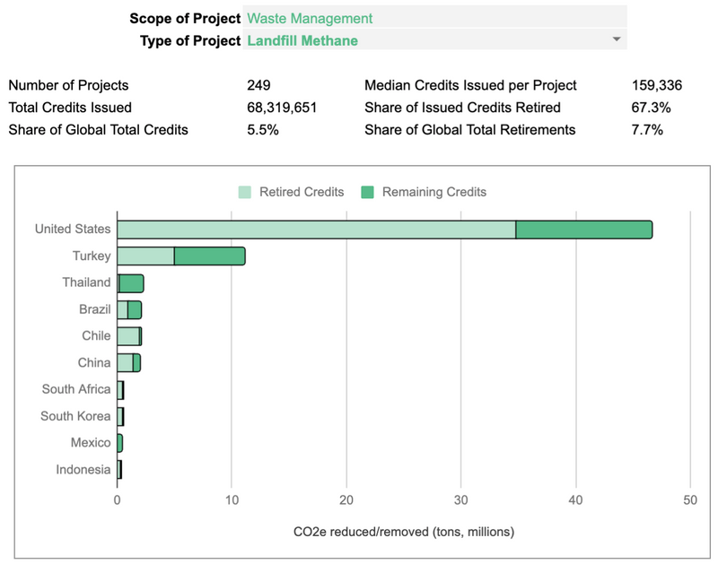
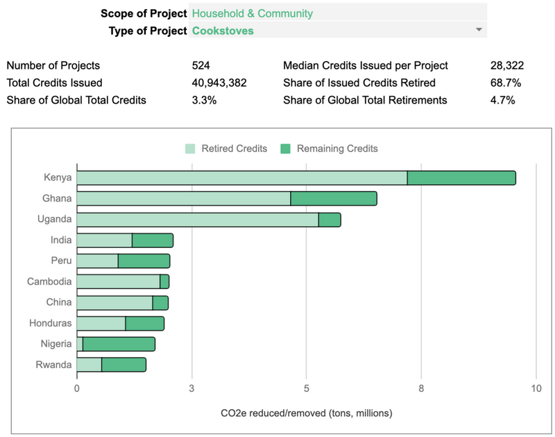
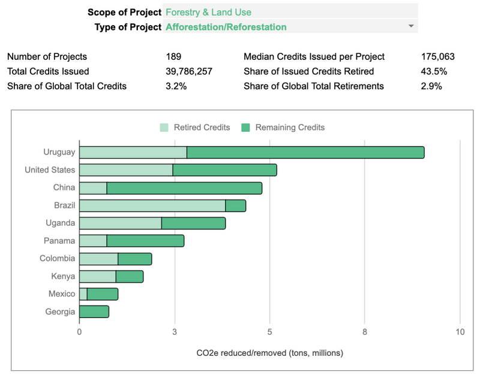
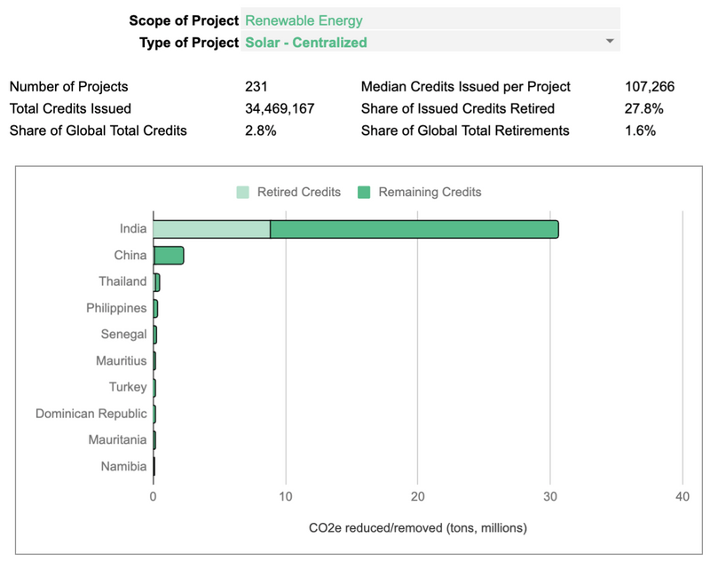
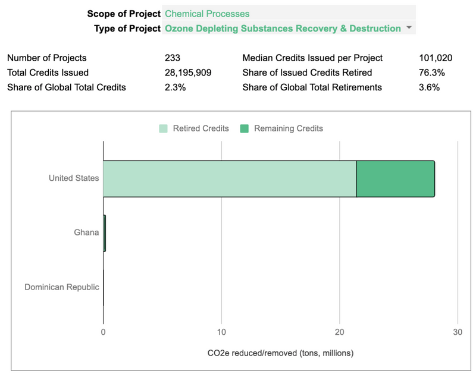
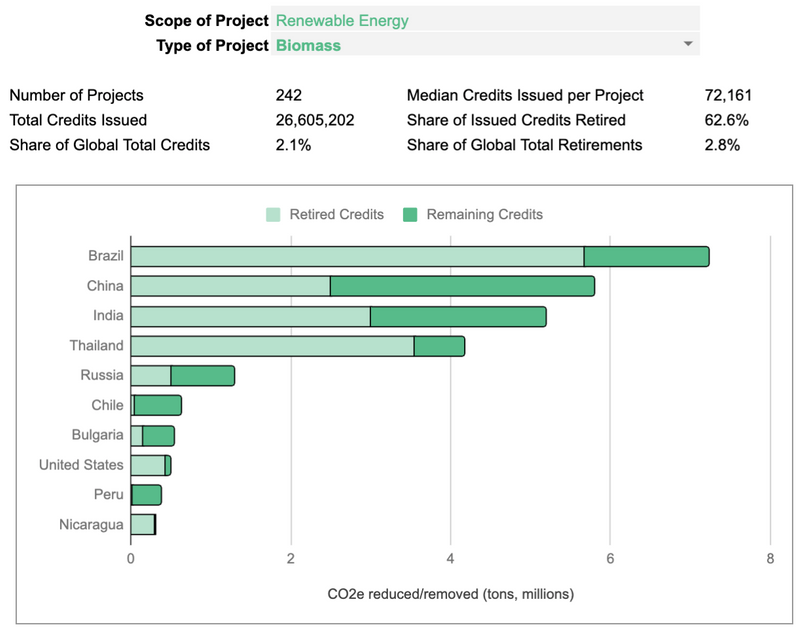

### Top 10 Types of Carbon Credit Offset Projects Globally

*December 4, 2021*

> This shows the top 10 types of voluntary carbon credit offset projects globally across multiple registries. All data are from UC Berkeley's carbon credits [database](https://gspp.berkeley.edu/faculty-and-impact/centers/cepp/projects/berkeley-carbon-trading-project/offsets-database). I built an easy-to-use Google Sheet to explore their dataset, which you can access [here](https://docs.google.com/spreadsheets/d/1rxJt3dqsSF4Yk299CQY1buU909luPLn0btE_ITVKa0E/edit?usp=sharing).

1/
🌳 **REDD+ / Forestry & Land Use**

This is the UN's flagship program to reduce emissions from deforestation and forest degradation, as well as the sustainable management of forests and the conservation and enhancement of forest carbon stocks in developing countries.

2/
🌳 **Improved Forest Management / Forestry & Land Use**

Private forest management projects, largely in the US.

Main providers are Blue Source LLC (20M), Forest Carbon Partners (20M), and The Nature Conservancy (10M). There are also several major projects on reservations.

3/
⚡️ **Wind / Renewable Energy**

Wind is by far the most popular project type. It also has among the highest share of retired credits, suggesting it may be a source of cheaper offsets.

Over 40M credits were issued in 2020, up from 28M in 2019 and 12M in 2018.

4/
⚡️ **Hydropower / Renewable Energy**

Hydro is also one the most popular source of offsets, with heavy concentration in India, China, and Turkey.

Three mega-projects in India generated 36M in offsets, or nearly a third of the entire sector's results.

5/
♻️ **Landfill Methane / Waste Management**

In the US, most landfill methane projects generate electricity or directly use the gas captured. EESI estimates such projects have an avg 14 and 54% IRR, respectively, making many worthwhile even in the absence of carbon credits.

6/
🔥 **Cookstoves / Household & Community**

Cookstove projects provide fuel-efficient alternatives to firewood, charcoal and other sources of cooking fuel in developing countries.

They're the 2nd most popular source of offsets and have a high share of retirement too.

7/
🌳 **Afforestation/Reforestation / Forestry & Land Use**

These projects remove carbon by planting new trees instead of conserving existing ones.

Outside Brazil, most countries have relatively low retirement rates, suggesting these may be more expensive sources of offsets.

8/
⚡️ **Solar - Centralized / Renewable Energy**

Centralized solar is not been a major source of credits. (Distributed solar isn't either - only 3.5M credits total.)

Nearly half of the total supply was issued by India in 2017.

9/
❄️ **Ozone Depleting Substances Recovery & Destruction / Chemical Processes**

These are popular only in the US, and there, only in Ohio (14.5M credits) and Arkansas (13M credits). They have a very high share of retirement. The leading seller is Reclamation Technologies Inc.

10/
⚡️ **Biomass / Renewable Energy**

This includes a variety of projects in agricultural, wood processing, or food processing sectors that produce bio-waste or residues.

They earn credits through methane avoidance, reducing deforestation, or avoiding fossil fuel use.

---

✨ Data source ✨

Barbara Haya, Ivy So, Micah Elias. (2021, September). Voluntary Registry Offsets Database, Berkeley Carbon Trading Project, University of California, Berkeley.

Retrieved from: [https://gspp.berkeley.edu/faculty-and-impact/centers/cepp/projects/berkeley-carbon-trading-project/offsets-database](https://gspp.berkeley.edu/faculty-and-impact/centers/cepp/projects/berkeley-carbon-trading-project/offsets-database)