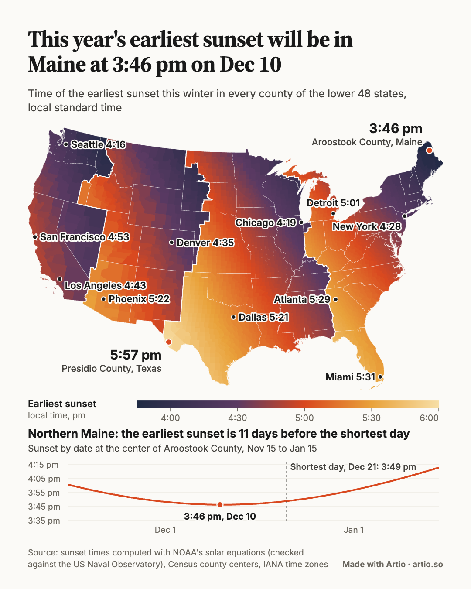
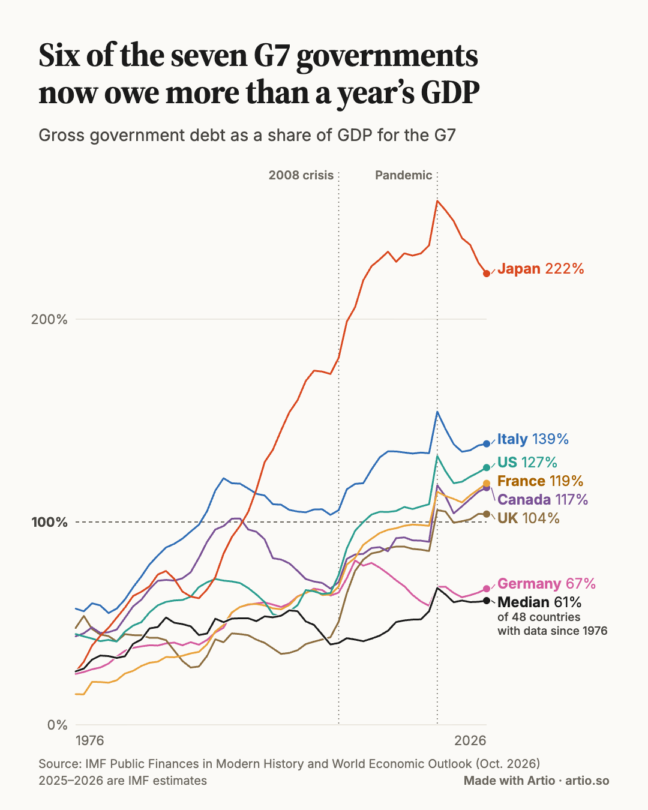
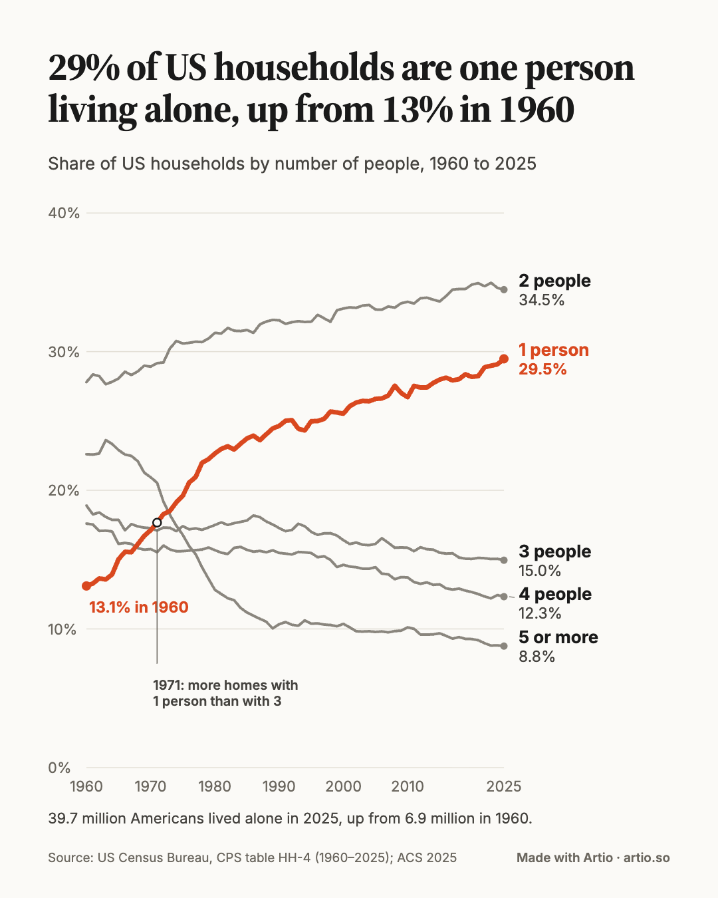
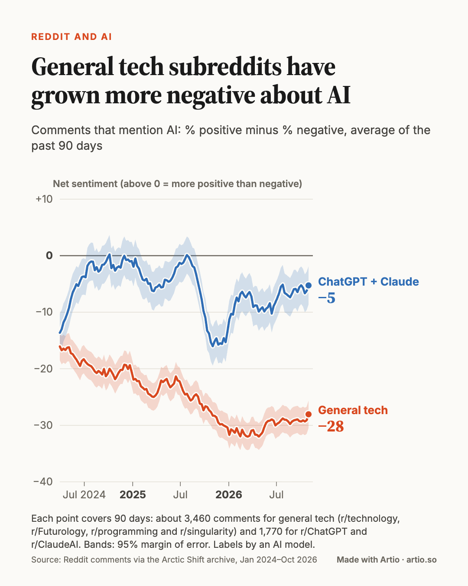
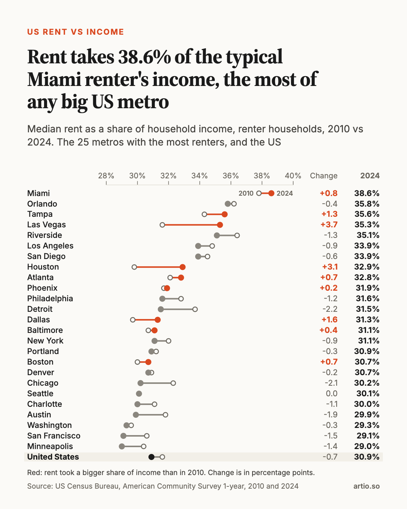

### Twelve charts on r/dataisbeautiful

*November 17, 2026*

This morning we posted a map of the earliest sunset in every county in the lower 48. Three hours later it had 1,778 upvotes and 279 comments, and it was still climbing.

It's the twelfth chart we've posted to [r/dataisbeautiful](https://www.reddit.com/r/dataisbeautiful/) since October 22. Every one of them was built end to end in [Artio](https://www.artio.so), the data platform we've been building (formerly Open Source Observer): data ingested, modeled and drawn on the platform, then posted by hand from [u/artio-data](https://www.reddit.com/user/artio-data/).

I've been making charts for fun for a long time (eg, [joyplotting coffee farms by altitude](joyplotting) and [topographic colormaps](topoloco)). This is the first time I've kept score.

### Why r/dataisbeautiful

The sub is a good test because it doesn't care who you are. Nobody upvotes a chart because of the logo in the corner. Most [OC] posts die quietly: the typical one gets about 50 upvotes, only 40% reach 100, and only 10% reach 1,000. The comments are a free peer review, and they are not gentle about a truncated axis or a missing source.

Disclosure: Artio is our product, so this is marketing. But it's also the most honest feedback loop we've found for the question we actually care about, which is whether the charts are any good.

### How we keep score

Raw upvotes are a noisy measure. A slow Tuesday and a busy Saturday are different markets. So we score each post by its **percentile**, the share of the sub's posts from the previous 30 days that it beat. That controls for how hot the sub was running when we posted.

We track everything on a [public portfolio page](https://www.artio.so/dataviz/pages/dib-portfolio) that refreshes daily from the Arctic Shift archive. Every post starts with a written hypothesis (eg, "a finding-first title on a relatable US money topic reaches 100+ upvotes and beats the descriptive-title post that follows it"), and the page records whether it came true.

Here's where things stood this morning, before the sunset map went up:

- 9 of our first 10 settled posts reached 100 upvotes, and 4 reached 1,000
- Our median post beat 87% of the sub's posts from the 30 days before it
- Our median post got 750 upvotes, against 50 for the typical [OC] post
- In November we're 5th of 551 posters by total upvotes, which puts us in the top 1%

In October, with three posts, we were 55th of 951.

### The charts

Newest first. Each title links to the Reddit thread; the "chart and method" link goes to the Artio page with the data and sources.

#### [This year's earliest sunset will be in Maine at 3:46 pm on Dec 10](https://www.reddit.com/r/dataisbeautiful/comments/1xyk1dx/oc_this_years_earliest_sunset_will_be_in_maine_at/)

Posted Nov 17 · 1,778 upvotes and 279 comments in its first three hours · [chart and method](https://www.artio.so/dataviz/pages/2026-11-17-earliest-sunset)

The hook is a fact most people don't know: the earliest sunset comes before the shortest day. In northern Maine, it's December 10, eleven days ahead of the solstice. The lower panel makes the point without any explanation. It was slated for next week. We moved it up this morning. Good call.

#### [Top US boys' names from the 1950s–90s are still popular. Most girls' aren't](https://www.reddit.com/r/dataisbeautiful/comments/1xw2qym/oc_top_us_boys_names_from_the_1950s90s_are_still/)

Posted Nov 14 · 2,454 upvotes · 598 comments · 96th percentile · [chart and method](https://www.artio.so/dataviz/pages/2026-11-14-baby-names)

Our best post so far. Everyone has a name, and everyone has an opinion about it.

#### [Six of the seven G7 governments now owe more than a year's GDP](https://www.reddit.com/r/dataisbeautiful/comments/1xubqrg/oc_six_of_the_seven_g7_governments_now_owe_more/)

Posted Nov 12 · 650 upvotes · 242 comments · 84th percentile · [chart and method](https://www.artio.so/dataviz/pages/2026-11-12-debt-to-gdp)

#### [22% of New York-area commuters take an hour or more to get to work](https://www.reddit.com/r/dataisbeautiful/comments/1xsnd68/oc_22_of_new_yorkarea_commuters_take_an_hour_or/)

Posted Nov 10 · 1,326 upvotes · 369 comments · 90th percentile · [chart and method](https://www.artio.so/dataviz/pages/2026-11-10-commute-times)

#### [29% of US households are one person living alone, up from 13% in 1960](https://www.reddit.com/r/dataisbeautiful/comments/1xryyzg/oc_29_of_us_households_are_one_person_living/)

Posted Nov 9 · 2,359 upvotes · 321 comments · 95th percentile · [chart and method](https://www.artio.so/dataviz/pages/2026-11-09-living-alone)

#### [General tech subreddits have grown more negative about AI](https://www.reddit.com/r/dataisbeautiful/comments/1xqa72d/oc_general_tech_subreddits_have_grown_more/)

Posted Nov 7 · 2,225 upvotes · 581 comments · 95th percentile · [chart and method](https://www.artio.so/dataviz/pages/2026-11-07-reddit-ai-mood)

Earlier posts on the sub about Reddit's mood on AI had scored roughly zero. Naming specific subreddits gave people something to argue about.

#### [In 2024, 38% of US ballots were cast on Election Day](https://www.reddit.com/r/dataisbeautiful/comments/1xohdfv/oc_in_2024_38_of_us_ballots_were_cast_on_election/)

Posted Nov 5 · 708 upvotes · 101 comments · 86th percentile · [chart and method](https://www.artio.so/dataviz/pages/2026-11-05-how-america-votes)

A county map of voting method, colored green, purple and gold so nobody could read a party into it.

#### [Homeownership rate in the US, by age group](https://www.reddit.com/r/dataisbeautiful/comments/1xl5j98/oc_homeownership_rate_in_the_us_by_age_group/)

Posted Nov 1 · 432 upvotes · 135 comments · 82nd percentile · [chart and method](https://www.artio.so/dataviz/pages/2026-11-02-homeownership-by-age)

#### [Rent takes 38.6% of the typical Miami renter's income, the most of any big US metro](https://www.reddit.com/r/dataisbeautiful/comments/1xftluj/oc_rent_takes_386_of_the_typical_miami_renters/)

Posted Oct 26 · 793 upvotes · 146 comments · 88th percentile · [chart and method](https://www.artio.so/dataviz/pages/2026-10-26-rent-vs-income)

#### [Complaints to the US consumer finance regulator about Equifax, Experian and TransUnion grew 87-fold from 2017 to 2026](https://www.reddit.com/r/dataisbeautiful/comments/1xcudkq/oc_complaints_to_the_us_consumer_finance/)

Posted Oct 22 · 343 upvotes · 28 comments · 80th percentile · [chart and method](https://www.artio.so/dataviz/pages/2026-10-22-cfpb-complaints)

Our first post. One big number on fresh public data.

### The misses

Two posts scored zero.

[How Americans spend an average day, by age group](https://www.reddit.com/r/dataisbeautiful/comments/1xiim1e/oc_how_americans_spend_an_average_day_by_age_group/) (Oct 29) was a perfectly fine chart of the American Time Use Survey with a perfectly boring title. [3 in 4 deaths of Americans aged 15 to 24 are from accidents, suicide or homicide](https://www.reddit.com/r/dataisbeautiful/comments/1xxsymt/oc_3_in_4_deaths_of_americans_aged_15_to_24_are/) (Nov 16) went nowhere too.

We keep the misses on the portfolio page. A scorecard that only shows the hits is a highlight reel.

### What we've learned so far

**Lead the title with the finding.** "Homeownership rate in the US, by age group" describes the chart. "29% of US households are one person living alone, up from 13% in 1960" tells you what it says. We ran this as a paired experiment twice. Rent vs income (finding-first) hit the 88th percentile; time use (descriptive) hit zero. Living alone (finding-first) hit the 95th; homeownership (descriptive) hit the 82nd.

**Give readers a way to place themselves in the chart.** Names, commutes, rent, sunsets. The best posts let you find your own city, your own age group or your own name and react to it. The comment sections fill up with people doing exactly that.

**Upvotes are not traffic.** The rent post sent 226 people to its Artio page on 793 upvotes. The living-alone post sent 20 on 2,359. Among the posts that cleared 100 upvotes, clicks per thousand upvotes ranged from 7 to 285. Reddit is a great place to find out if a chart works. It's a less reliable place to send people anywhere else.

**Write the hypothesis down before you post.** It's easy to explain any result after the fact. Writing "this reaches 1,000" or "this beats the 90th percentile" ahead of time forces you to say what you actually expect, and makes the misses useful.

### Caveats

- Twelve posts is a small sample. The title experiments are two pairs on different topics, so treat them as directional.
- Upvote counts move for a day or two after posting. The numbers above are the latest captures from the archive; the sunset map's count is a snapshot from three hours in.
- The best account on the sub, which we benchmark against, gets 70% of its posts past 1,000 upvotes. We're at 40%. There's a long way to go.

Next up from the bench: Thanksgiving flight delays, a 3x3 grid of chain restaurant rivals, and the share of teenagers with a driver's license. The scorecard updates every morning.
