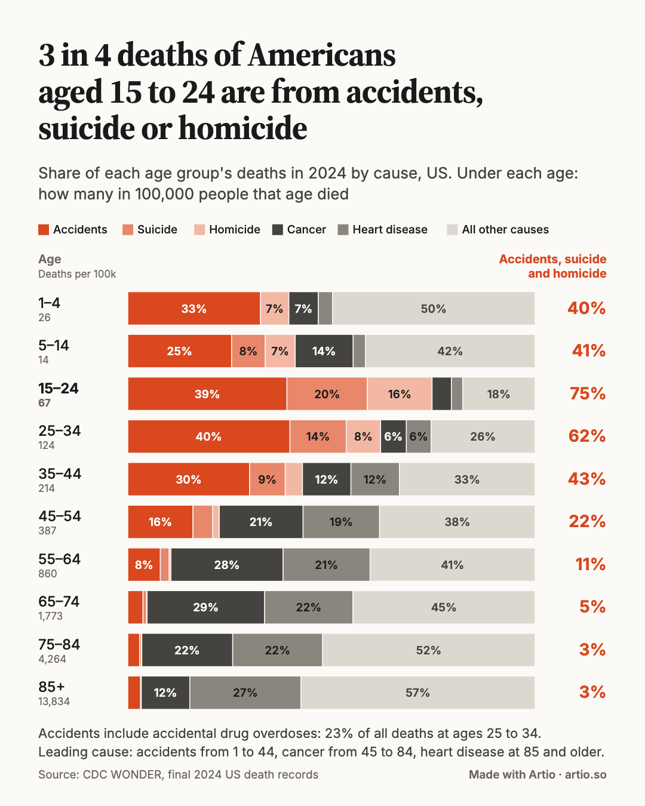
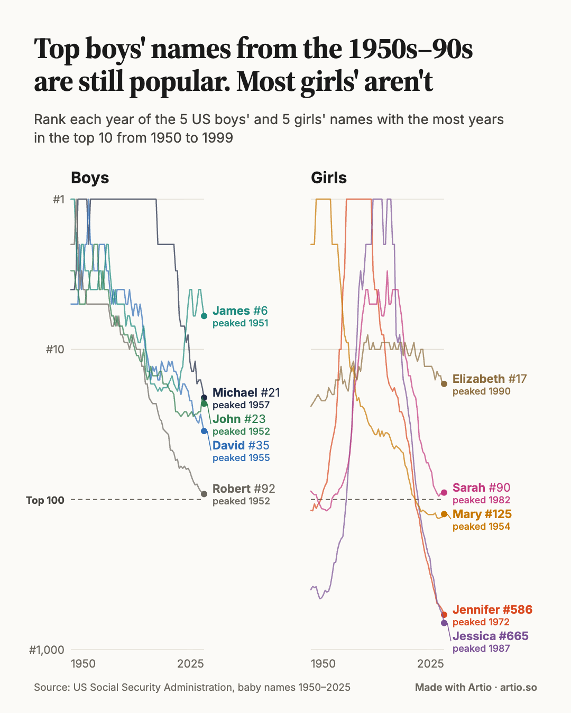
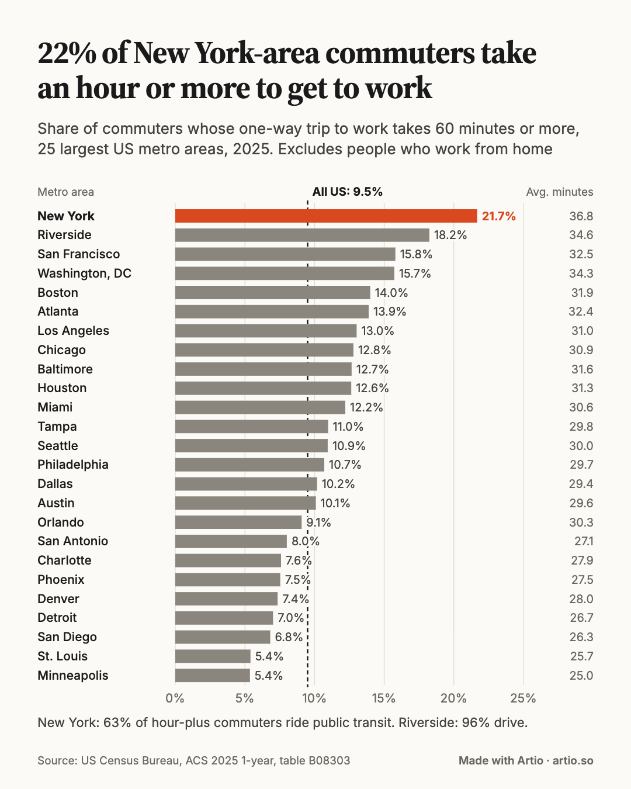
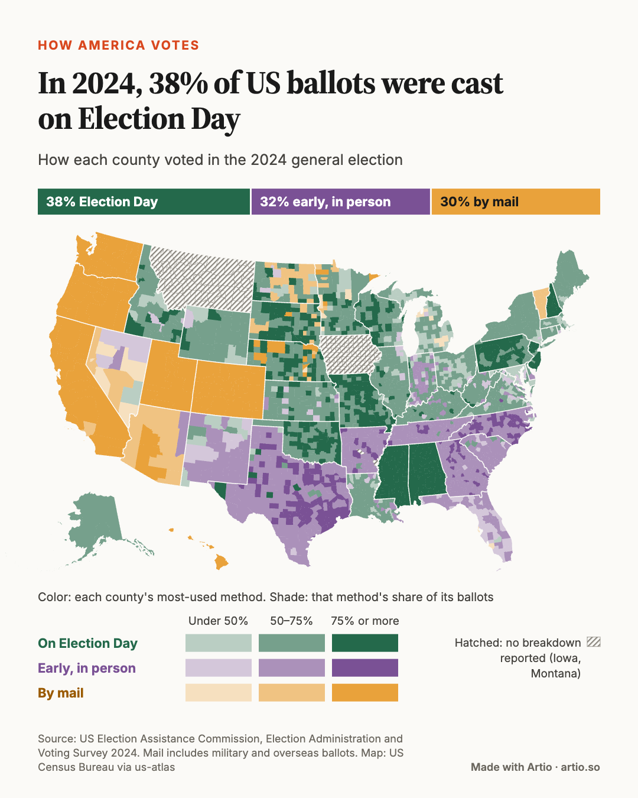
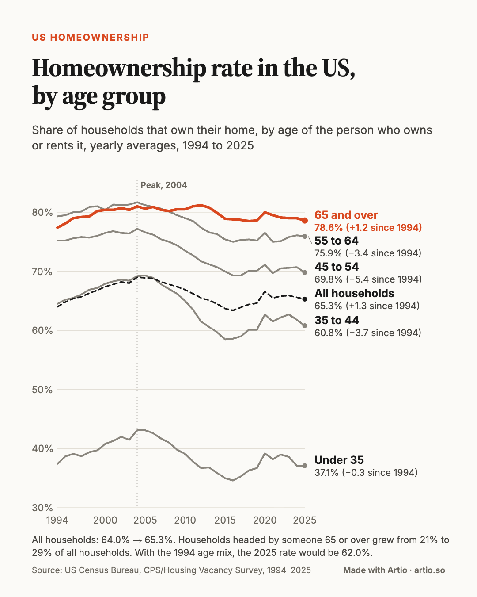
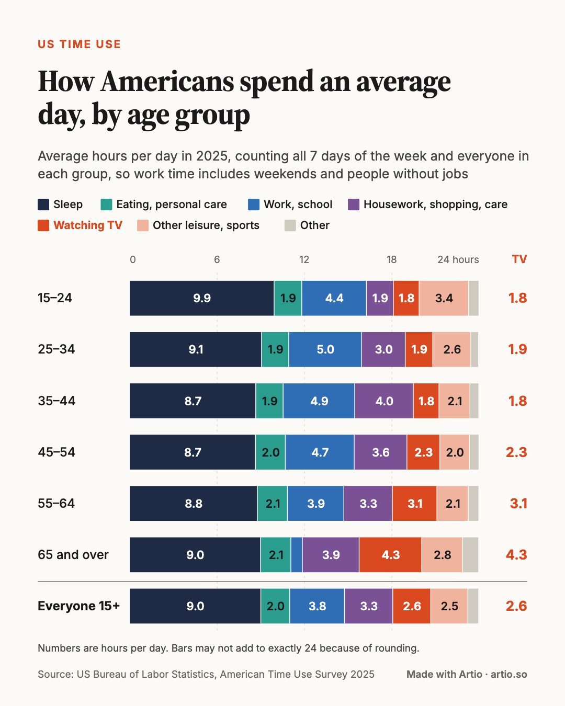
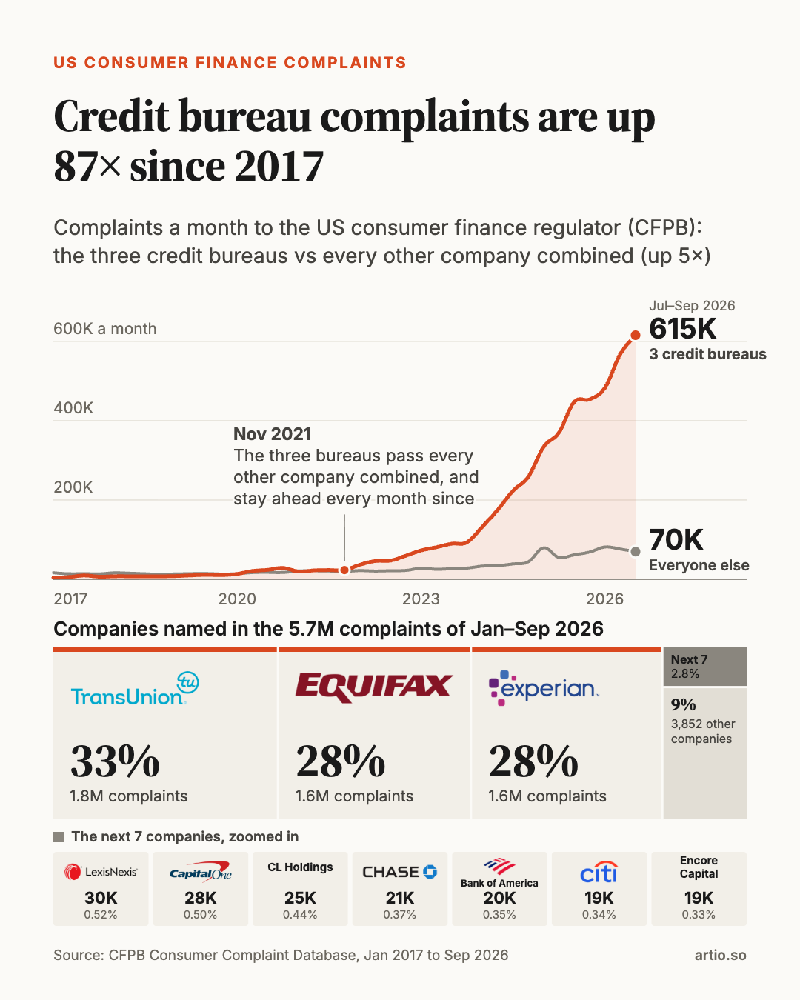

### An experiment with r/dataisbeautiful

*November 17, 2026*

I've always enjoyed making data visualizations. A couple of my favorites from a few years ago were a [joyplot of coffee farms by altitude](joyplotting) and a series of [topographic maps](topoloco) I made in Python.

One of the fun things about building [Artio](https://www.artio.so) is that I get to do a lot more of this.

Over the past month, we've been running a little experiment with [r/dataisbeautiful](https://www.reddit.com/r/dataisbeautiful/). We wanted to see how good we could get at using agents to research interesting topics, ingest public datasets, and produce data visualizations that people would actually enjoy.

Here's one we published this morning, showing the date and time of the earliest sunset of the year in every county in the contiguous US. Within five hours, it had nearly 4,000 upvotes and over 500 comments, our most viral post so far.

(Fun fact: the earliest sunset of the year is not on the shortest day of the year. In northern Maine it comes on December 10, eleven days before the solstice.)

## The experiment

I'm interested in how we evaluate the quality of outputs from agents, particularly for the less deterministic parts of data science (eg, exploratory analysis, data visualization, storytelling).

A forum like r/dataisbeautiful is an ideal test environment. There's a large community of people who appreciate good data visualizations, an extensive corpus of historical posts to analyze, and a lot of qualitative feedback in the comments. People are also pretty quick to point out issues with your data or methodology.

Most posts don't get far. When we pulled two years of the sub's history, 57% of the 30,936 submissions had been removed by moderators, AutoModerator or Reddit. Of the posts that stayed up, the median got 9 upvotes.

We've been using Artio for the entire process:

- Analyzing historical posts on r/dataisbeautiful
- Researching topics and finding interesting public datasets
- Ingesting and modeling the data
- Iterating on visualizations and titles
- Measuring the performance of each post

We've also been asking the agents to write down a hypothesis for how each chart will perform before we publish it (eg, "a single striking county map about a shared everyday experience, with a known surprise, reaches 1,000+ upvotes").

We track the results in our own private dashboard, which updates daily and shows each post's hypothesis next to how it actually did.

## How the agents work

The work is split across a handful of scheduled agents, each with one job:

- A **trend scan** runs every Sunday. It reads the sub's posts from the last 7, 30 and 90 days, works out which topics and title patterns are breaking out, and refreshes a ranked backlog of topics, each with a named public data source.
- A **self-improvement review** runs right after it. It scores each of our posts against its hypothesis and against the sub, then edits a playbook of rules. Every rule carries its evidence (post ids, counts, medians) and a confidence level, and old evidence is never deleted.
- A **content prep** agent runs four times a week. It picks the top topic from the backlog, ingests the data, builds the chart in our design system, and checks it at phone width, reconciling every number on the chart against the underlying tables. Its goal is to keep three finished posts on the bench.
- A **promotion** agent ranks the bench, predicts a score range and the odds of reaching 1,000 upvotes for each post, and asks a human which one should go up next.
- A **daily review** checks that the data pipeline is flowing, settles each post's score once it's 36 hours old, and summarizes what commenters praised, criticized or asked for.

The human (ie, me) makes the editorial calls. I still pick which post goes up, approve any change to the design system, and do the actual posting on Reddit myself. 

The scoring data comes from the [Arctic Shift](https://arctic-shift.photon-reddit.com/) archive of Reddit, which re-captures posts after they've had time to settle. We compare each post by its percentile, the share of the sub's posts from the previous 30 days that it beat. That matters because the sub has gotten more active this year: a 90th-percentile post now needs about 1,150 upvotes.

## How we've done so far

The results have been pretty encouraging. Of our first ten posts with settled scores:

- Nine received over 100 upvotes and four received over 1,000.
- Our median post received 750 upvotes, compared with about 50 for a typical original content post on the subreddit.
- Our median post was in the 87th percentile relative to posts in the preceding 30 days.

So far in November 2026, our account ranks fifth out of 551 contributors by total upvotes, putting us in the top 1% of all posters on the forum.

We've also had two posts get zero upvotes. Both are in the gallery below.

I'd like to extend this experiment to other types of data science work where we can get independent feedback on the quality of the outputs. In the meantime, we'll keep making charts. You can follow along on [Reddit](https://www.reddit.com/user/artio-data/).

## All twelve charts

Newest first.

**[This year's earliest sunset will be in Maine at 3:46 pm on Dec 10](https://www.reddit.com/r/dataisbeautiful/comments/1xyk1dx/oc_this_years_earliest_sunset_will_be_in_maine_at/)** 
Nov 17 · currently trending (shown above) · [Artio](https://www.artio.so/dataviz/pages/2026-11-17-earliest-sunset)

**[3 in 4 deaths of Americans aged 15 to 24 are from accidents, suicide or homicide](https://www.reddit.com/r/dataisbeautiful/comments/1xxsymt/oc_3_in_4_deaths_of_americans_aged_15_to_24_are/)** 
Nov 16 · 0 upvotes · [Artio](https://www.artio.so/dataviz/pages/2026-11-16-causes-of-death)

**[Top US boys' names from the 1950s–90s are still popular. Most girls' aren't](https://www.reddit.com/r/dataisbeautiful/comments/1xw2qym/oc_top_us_boys_names_from_the_1950s90s_are_still/)** 
Nov 14 · 2,454 upvotes · [Artio](https://www.artio.so/dataviz/pages/2026-11-14-baby-names)

**[Six of the seven G7 governments now owe more than a year's GDP](https://www.reddit.com/r/dataisbeautiful/comments/1xubqrg/oc_six_of_the_seven_g7_governments_now_owe_more/)** 
Nov 12 · 650 upvotes · [Artio](https://www.artio.so/dataviz/pages/2026-11-12-debt-to-gdp)

**[22% of New York-area commuters take an hour or more to get to work](https://www.reddit.com/r/dataisbeautiful/comments/1xsnd68/oc_22_of_new_yorkarea_commuters_take_an_hour_or/)** 
Nov 10 · 1,326 upvotes · [Artio](https://www.artio.so/dataviz/pages/2026-11-10-commute-times)

**[29% of US households are one person living alone, up from 13% in 1960](https://www.reddit.com/r/dataisbeautiful/comments/1xryyzg/oc_29_of_us_households_are_one_person_living/)** 
Nov 9 · 2,359 upvotes · [Artio](https://www.artio.so/dataviz/pages/2026-11-09-living-alone)

**[General tech subreddits have grown more negative about AI](https://www.reddit.com/r/dataisbeautiful/comments/1xqa72d/oc_general_tech_subreddits_have_grown_more/)** 
Nov 7 · 2,225 upvotes · [Artio](https://www.artio.so/dataviz/pages/2026-11-07-reddit-ai-mood)

**[In 2024, 38% of US ballots were cast on Election Day](https://www.reddit.com/r/dataisbeautiful/comments/1xohdfv/oc_in_2024_38_of_us_ballots_were_cast_on_election/)** 
Nov 5 · 708 upvotes · [Artio](https://www.artio.so/dataviz/pages/2026-11-05-how-america-votes)

**[Homeownership rate in the US, by age group](https://www.reddit.com/r/dataisbeautiful/comments/1xl5j98/oc_homeownership_rate_in_the_us_by_age_group/)** 
Nov 1 · 432 upvotes · [Artio](https://www.artio.so/dataviz/pages/2026-11-02-homeownership-by-age)

**[How Americans spend an average day, by age group](https://www.reddit.com/r/dataisbeautiful/comments/1xiim1e/oc_how_americans_spend_an_average_day_by_age_group/)** 
Oct 29 · 0 upvotes · [Artio](https://www.artio.so/dataviz/pages/2026-10-29-time-use-by-age)

**[Rent takes 38.6% of the typical Miami renter's income, the most of any big US metro](https://www.reddit.com/r/dataisbeautiful/comments/1xftluj/oc_rent_takes_386_of_the_typical_miami_renters/)** 
Oct 26 · 793 upvotes · [Artio](https://www.artio.so/dataviz/pages/2026-10-26-rent-vs-income)

**[Complaints to the US consumer finance regulator about Equifax, Experian and TransUnion grew 87-fold from 2017 to 2026](https://www.reddit.com/r/dataisbeautiful/comments/1xcudkq/oc_complaints_to_the_us_consumer_finance/)** 
Oct 22 · 343 upvotes · [Artio](https://www.artio.so/dataviz/pages/2026-10-22-cfpb-complaints)
